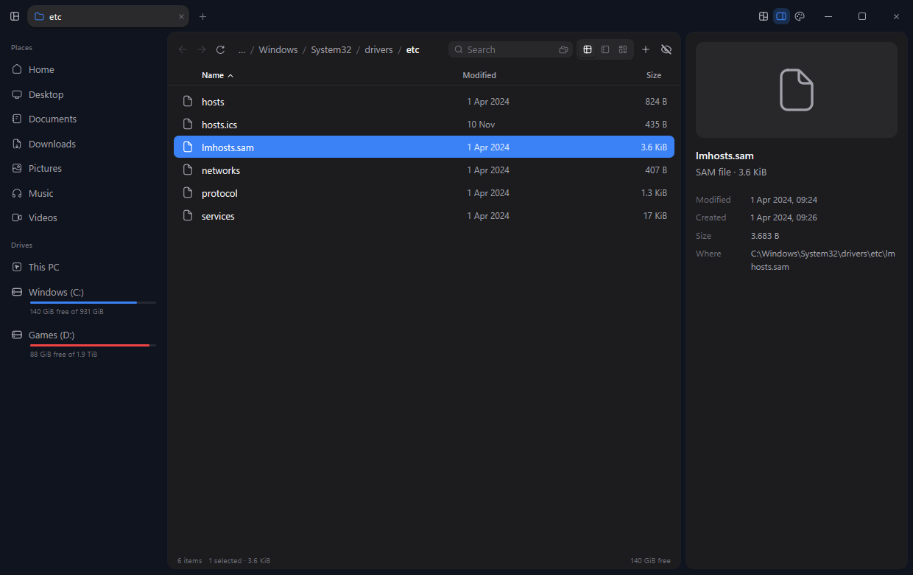
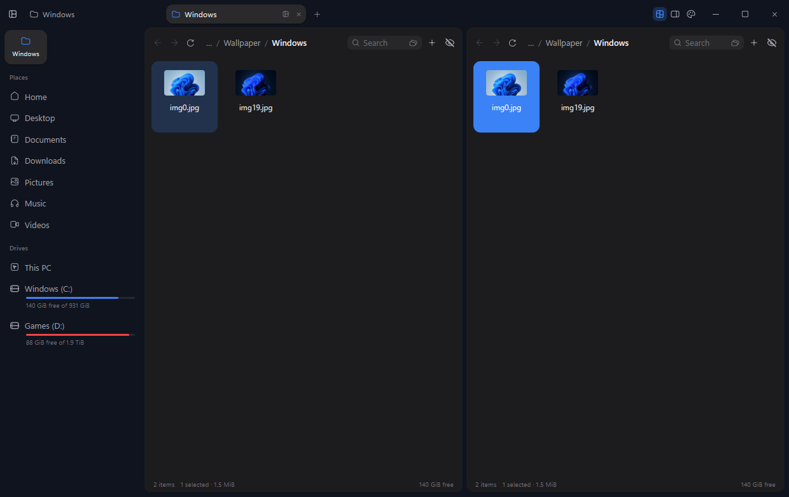
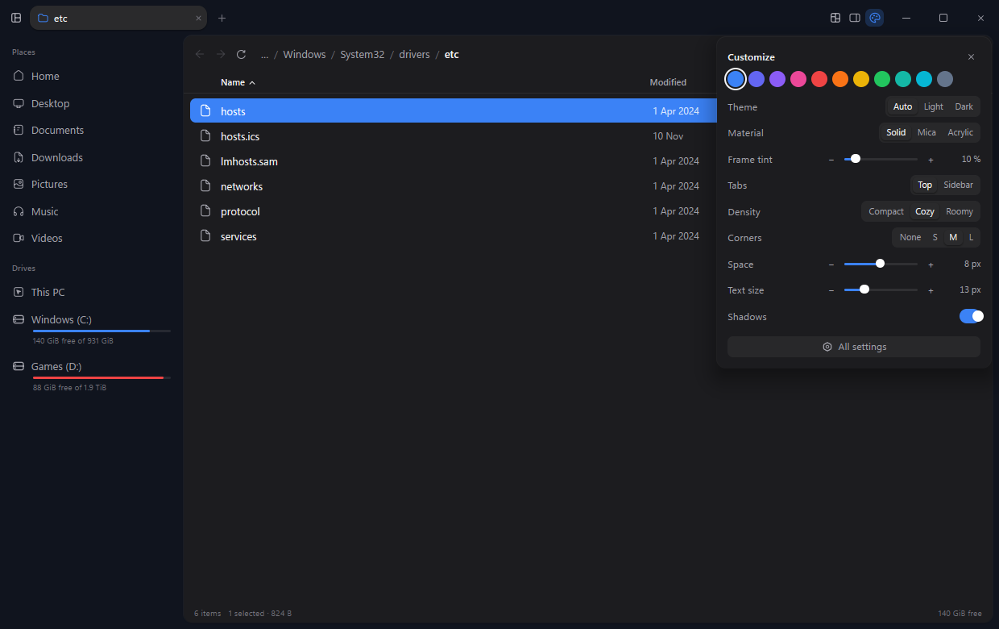

# File explorer

A file explorer for Windows built with rsui, Tailwind CSS 4 and [Blode Icons](https://blode.co/icons), laid out like a modern
browser such as Arc: tabs along the top or down the side, a sidebar on the window's frame, and folders on panels you can split and
resize. It opens a folder of 25,000 files about as fast as a folder of 25, and almost every part of it can be changed.



## Running it

From this folder, with `rsui-tsx` installed (see the [root README](../../README.md)):

```
npm install
rsui-tsx app.tsx
```

The window updates as you save. `rsui-tsx --pack file-explorer.exe app.tsx` makes a single program you can hand to someone, with
nothing else to install. Set `FILE_EXPLORER_START` to a folder to open there, in one tab, instead of where the settings say.

## What it does

- Tabs, along the top or down the sidebar, which it reopens next time, each with its own history
- Split panes, side by side and above one another in any arrangement: split right (`Ctrl+\`) or down (`Ctrl+Shift+\`), pick a
  layout (two, three, one beside two, a grid of four) from the Layout menu, or drag a tab from the tab bar onto the panes: a
  see-through sheet shows where it'll land as you move, near the outer edge it goes beside all of them, and the tab you're in opens
  its folder there in a new pane. "Open
  beside" and "Open below" are on a folder's menu, and `Ctrl+Alt+arrows` move between panes
- Panels you resize by dragging the space between them: the sidebar, each pair of panes, and the preview. Double-click between
  panes to even them out. Panes keep to a smallest size, and a split there's no room for says so instead
- A sidebar that collapses to a rail of icons when you drag it narrower than it goes (or `Ctrl+Shift+B`), and on its own in a narrow
  window
- Panels glide to their new places and sizes when you split, close, collapse or hide something, and follow the pointer at once
  while you drag or resize the window. Nothing in the app knows how big the window is: the panes are flex boxes, each as big as
  its share of the split it's in, so the page lays them out, and what glides is a share (`flex-grow`), not a size
- Its own title bar, with the window's buttons beside the tabs, and Windows 11's Mica or Acrylic showing through the frame
- Details, list and grid views, with thumbnails of photos, videos and documents in the grid
- A sidebar with pinned folders as favorites, places, and every drive with how full it is
- A preview pane that shows pictures, the start of text and code files, and each item's details
- Breadcrumbs you can click, or type a path (`Ctrl+L`)
- Filter the folder as you type, or search everything below it, matching by contains, prefix, fuzzy, wildcards or a regex
- Rename in place, new folders, delete to the Recycle Bin or for good, and cut, copy and paste that work with Explorer's clipboard
- Drag files out to other programs, and drop files in to copy them (hold Shift to move)
- Right-click menus with the usual commands, open with, open in a terminal, show in Explorer and properties
- Back and forward history, typing a name to jump to it, and Shift and Ctrl selection with the mouse and keyboard
- Updates on its own when files change in the open folder



## Customize and settings

Customize (`Ctrl+K`, or the palette button) changes how it looks in one place: the accent, light or dark, the window's material and
how much of the desktop shows through, how much of the accent the frame takes, where the tabs go, density, corners, the space
between panels, text size and shadows. Each changes as you pick it.



Everything else is in the settings (`Ctrl+,`): 88 settings and 39 shortcuts in twelve sections, which you can search. Each one
applies as you change it, and the ones you've changed show a Reset link.

| Section | What you can change |
|---|---|
| Appearance | Theme, accent color (eleven presets or any color), neutral palette, font, text size, density, corner radius, selection style, striped rows, row lines, animations, Windows 11's Mica or Acrylic material, how see-through the frame is, its tint, the space between panels, and their shadows |
| Icons | Blode or Windows icons, icon size and line weight, accent-colored folders, colors by file type, thumbnails in the grid |
| Layout | Default view, grid tile size, tabs along the top or down the sidebar, reopening tabs, the toolbar, breadcrumbs or a plain path, sidebar, collapsed or not, its width and sections, drive usage bars, preview pane and its width, status bar |
| Columns | Column headers, and which of size, type, modified, created and attributes to show |
| Files & folders | Hidden and system files, treating dot files as hidden, fading hidden items, extensions, folders first, sort order, natural number order, case-sensitive sorting, a view and sort remembered per folder, date and size formats, 12 or 24-hour clock |
| Behavior | Single or double click to open, where it starts, confirming deletes, the Recycle Bin, live updates, type-to-jump, Backspace to go up, wrap-around arrow keys, what rename selects, the terminal command |
| Search | Subfolders by default, how deep, how many results, match mode, case, hidden items, how long to wait before searching |
| Preview | Pictures, text, how much text to read, monospace, wrapping, details |
| Performance | Rows drawn past the edge, thumbnails kept, sharing Windows icons by type, timings in the status bar |
| Keyboard | Every one of the 39 shortcuts can be rebound, and clashes are flagged |
| Pinned folders | Reorder or remove what the sidebar keeps |
| Backup & reset | Export or import settings as JSON, through a file or the clipboard, or reset everything |

## Shortcuts

These are the defaults. All of them can be changed under Keyboard.

| Keys | Does |
|---|---|
| `Ctrl+T`, `Ctrl+W` | New tab, close tab |
| `Ctrl+Tab`, `Ctrl+Shift+Tab` | Next and previous tab |
| ``Ctrl+\``, ``Ctrl+Shift+\`` | Split the pane right, or down |
| `Ctrl+Shift+W`, `Ctrl+Shift+=` | Close the pane, make the panes the same size |
| `Ctrl+J`, `Ctrl+Alt+←` `→` `↑` `↓` | Next pane, the pane in that direction |
| `Ctrl+K` | Customize |
| `Alt+←` `Alt+→` `Alt+↑` | Back, forward, up a folder |
| `Enter`, `Backspace` | Open, go up |
| `F2`, `Delete` | Rename, delete |
| `Ctrl+C` `Ctrl+X` `Ctrl+V` | Copy, cut, paste |
| `Ctrl+Shift+N` | New folder |
| `Ctrl+L`, `Ctrl+F` | Edit the address, search |
| `Ctrl+1` `Ctrl+2` `Ctrl+3` | Details, list, grid |
| `Ctrl+H`, `Ctrl+B`, `Ctrl+P` | Hidden items, sidebar, preview |
| `Ctrl+Shift+B` | Collapse or expand the sidebar |
| `Ctrl+D` | Pin the folder to the sidebar |
| ``Ctrl+` `` | Open a terminal here |
| `Ctrl+Shift+C`, `Alt+Enter` | Copy the path, properties |
| `F5`, `Ctrl+,` | Refresh, settings |

## How it stays fast

Measured on a Ryzen 7800X3D, in `C:\Windows\WinSxS` (25,198 folders and files) and with the timings setting on:

| | |
|---|---|
| Reading the folder, with every size, date and attribute | about 80 ms, on another thread |
| Sorting it by name | about 2 ms |
| Jumping to the last item with `End` | one 7 ms frame |
| Opening a normal folder | one frame of about 20 ms |

What makes the difference:

- **One pass over the folder.** rsui's `files.list` reads names, sizes, dates and attributes in the same pass Windows uses to list
  the folder, rather than asking about each file afterwards, and returns them already in Explorer's name order.
- **Sorting without comparing strings.** Since the names arrive in order, sorting by name or by any other column is a comparison of
  numbers. `Intl.Collator` took 651 ms for the same folder.
- **Native rows.** The list is rsui's own `<list>`, which only builds the rows on screen and scrolls them in Rust, and each row is
  made of `<row>` and `<text>`. It's as big as layout makes it, and works out what fits from that; the grid is the same `<list>`
  with an `itemWidth`, which wraps its tiles itself and says how many fit across, for the arrow keys. Everything around it is Tailwind. With rows built from styled `<div>`s, jumping to the end of
  WinSxS took a 73 ms frame instead of 7 ms.
- **Rows that skip work.** Rows and panels are wrapped in `memo`, and get the same functions on every render, so moving the selection
  redraws two rows.
- **Icons imported one by one.** `src/icons.ts` imports each Blode icon from its own file. Importing from the package root loads all
  6,116 icons, which added about 470 ms to every start.

## Files

| File | What's in it |
|---|---|
| `app.tsx` | The window: settings, tabs and their panes, resizing the panels, the window's own shortcuts, and the layout |
| `src/layout.ts` | How a tab's panes are laid out: a tree of rows and columns, splitting, closing, resizing and the ready-made layouts |
| `src/Splits.tsx` | That tree drawn as flex boxes, each part its share of its split, with a handle in each gap |
| `src/Panes.tsx` | Each pane's place, the handles between them, where a dragged tab would dock, and the Layout menu |
| `src/Pane.tsx` | One folder in a tab: its history, reading it, searching, selecting, doing things to files, its keyboard and menus |
| `src/Chrome.tsx` | The tabs, the window's buttons, the handles between panels, and Customize |
| `src/settings.ts` | Every setting, its default, and how the settings screen shows it |
| `src/SettingsPage.tsx` | The settings screen, drawn from `settings.ts` |
| `src/List.tsx` | The details, list and grid views, on rsui's native `<list>` |
| `src/files.ts` | Reading, sorting, formatting, searching, copying and moving |
| `src/Toolbar.tsx`, `src/Sidebar.tsx`, `src/Preview.tsx` | The bar on each panel, the sidebar, and the preview |
| `src/FileIcon.tsx`, `src/icons.ts`, `src/thumbs.ts` | Icons and thumbnails |
| `src/theme.ts`, `app.css` | Colors from the settings, as CSS variables for Tailwind: the frame, the panels on it, and the rest |
